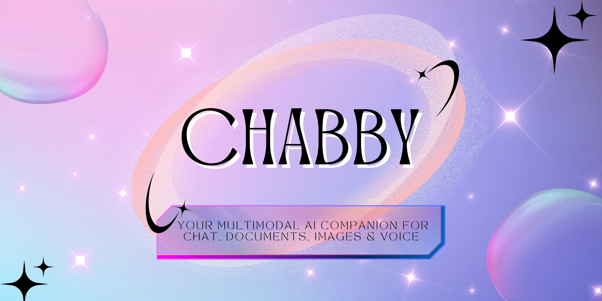

# ✨ Chabby ✨ — Your Little AI Companion

<p align="center">
  
</p>

<p align="center">
  <strong>Your shiny little corner of the internet ✦ powered by curiosity.</strong>
  <br>
  A multimodal AI chatbot designed to make conversations, learning, and exploring information easier.
</p>

<p align="center">
  
  
  
  
  
</p>

---

## 👋 Introduction

**Chabby AI** is a personal multimodal AI chatbot built to bring different forms of AI interaction together in one simple, friendly workspace.

Instead of limiting conversations to text, Chabby allows users to interact through text, images, documents, and voice. It combines language models with document retrieval capabilities to help users ask questions, explore information, understand uploaded files, and have more natural conversations.

Built with Python and Streamlit, Chabby focuses on making AI accessible through a clean, pastel-inspired interface while integrating powerful AI models through OpenRouter.

Whether you're asking questions, studying from PDFs, exploring an image, or simply having a conversation, Chabby is here to help. 🌷

## ✨ Features

### 💬 1. Intelligent AI Conversations

Chat naturally with Chabby using AI language models.

- Conversational text interactions.
- Friendly and consistent Chabby identity.
- Context-aware conversation history.
- Model fallback support when a provider is unavailable.

### 📚 2. PDF Understanding & Retrieval-Augmented Generation (RAG)

Upload PDF documents and ask questions about their contents.

Chabby uses Retrieval-Augmented Generation (RAG) to retrieve relevant information from uploaded documents before generating responses.

**How it works:**

1. Upload a PDF document.
2. Chabby extracts its text.
3. The extracted content is divided into smaller chunks.
4. Sentence Transformers generate multilingual embeddings.
5. ChromaDB stores the document vectors.
6. Relevant content is retrieved when a question is asked.
7. The language model generates an answer using the retrieved information.

This helps users interact with their own documents instead of relying only on general model knowledge.

### 🖼️ 3. Image Understanding

Interact with images through multimodal AI capabilities.

- Upload images.
- Ask questions about uploaded images.
- Get descriptions and explanations.
- Explore visual information through conversation.

### 🎙️ 4. Voice Input & Speech Recognition

Talk to Chabby instead of typing every message.

- Record voice messages.
- Convert speech into text.
- Review transcribed messages before sending.
- Support language selection for speech recognition.

### 🔊 5. Text-to-Speech Responses

Listen to Chabby's responses through generated speech.

- Convert text responses into audio.
- Listen to answers directly inside the chatbot.
- Choose a conversation language.

### 🌍 6. Multilingual Interaction

Chabby includes language selection to make interactions more accessible.

Languages offered include:

- English
- Hindi
- Bengali
- Nepali
- Tamil
- Telugu
- Marathi
- Gujarati
- Punjabi
- Urdu

Actual speech recognition and speech generation availability depends on the external services.

### 💗 7. Chat History & Conversation Management

Keep conversations organised without losing previous discussions.

- Start new conversations.
- Reopen previously saved chats.
- Keep separate conversations for different topics.
- Preserve chat history locally between app restarts.

### 🎀 8. A Friendly User Interface

Chabby features a soft, pastel-inspired interface designed around simplicity and usability.

- Pink, lavender, and baby-blue gradients.
- Rounded interface elements.
- Readable text and clear contrast.
- Simple document and image uploads.
- Easy conversation navigation.

---

## 🛠️ Technology Stack

| Technology | Purpose |
|---|---|
| Python | Core programming language |
| Streamlit | Web application interface |
| OpenRouter | AI model API integration |
| NVIDIA Nemotron | Language and vision models |
| LangChain | LLM integration and document workflows |
| ChromaDB | Vector database for document retrieval |
| Sentence Transformers | Text embeddings |
| PyPDF | PDF text extraction |
| SpeechRecognition | Speech-to-text |
| gTTS | Text-to-speech |
| Pillow | Image handling |

## 🧠 AI Models

Chabby uses OpenRouter to connect with selected NVIDIA Nemotron models.

| Model | Intended use |
|---|---|
| NVIDIA Nemotron 3.5 Lightning | Primary text conversations |
| NVIDIA Nemotron 3.5 Super VL | Image understanding |
| NVIDIA Nemotron 3 Ultra | Reasoning fallback |

Model availability depends on OpenRouter and the availability of the respective providers. Free models may have rate limits.

---

## 🚀 Installation

Follow these steps to run Chabby locally.

### 1. Clone the repository

```bash
git clone https://github.com/YOUR-USERNAME/Chabby-AI-Chatbot.git
```

Navigate into the project:

```bash
cd Chabby-AI-Chatbot
```

### 2. Create a virtual environment

Python 3.12 is recommended.

```bash
py -3.12 -m venv .venv
```

Activate it on Windows:

```bash
.venv\Scripts\activate
```

### 3. Install dependencies

```bash
python -m pip install --upgrade pip
```

```bash
pip install -r requirements.txt
```

### 4. Configure your API key

Create a `.env` file in the project directory.

Add your OpenRouter API key:

```env
OPENROUTER_API_KEY=your_openrouter_api_key
```

Get an API key from [OpenRouter](https://openrouter.ai/).

**Important:** Never upload your `.env` file or expose your API key publicly.

### 5. Run Chabby

```bash
python -m streamlit run app.py
```

Chabby should now open in your browser!

---

## 📂 Project Structure

```text
Chabby-AI-Chatbot/
│
├── app.py                  # Main Streamlit application
├── model_router.py         # AI model configuration and routing
├── rag_engine.py           # PDF processing and RAG pipeline
├── requirements.txt        # Project dependencies
├── .env                    # API key (not committed)
├── .gitignore              # Git ignored files
├── chabby_chats.json       # Local conversation history
│
└── chabby_memory/          # Optional local vector storage
```

*Local runtime files may be generated when the application is used.*

---

## ⚙️ How Chabby Works

Chabby brings multiple AI capabilities into one application.

```text
                 USER
                   |
                   v
             CHABBY AI
                   |
        +----------+----------+
        |          |          |
        v          v          v
      TEXT       IMAGES      FILES
        |          |          |
        v          v          v
    NVIDIA      Vision     PDF Text
    Nemotron    Model      Extraction
        |          |          |
        |          |          v
        |          |      Text Chunks
        |          |          |
        |          |          v
        |          |     Embeddings
        |          |          |
        |          |          v
        |          |       ChromaDB
        |          |          |
        +----------+----------+
                   |
                   v
             AI RESPONSE
                   |
             +-----+-----+
             |           |
             v           v
          TEXT CHAT   VOICE OUTPUT
```

---

## 🔮 Future Improvements

Chabby is an evolving project. Potential areas for improvement include:

- OCR support for scanned PDF documents.
- Improved long-term document memory.
- More robust multilingual speech support.
- Better image and document conversation continuity.
- Additional multimodal model integrations.
- Improved response streaming and performance.
- More customisation options for the user interface.

---

## 🔐 Privacy & Limitations

- API requests are processed by external AI providers through OpenRouter.
- Voice transcription and speech generation use online services.
- PDF embeddings are generated locally.
- PDF vector memory currently lasts for the active application session.
- Chat history is stored locally on the user's computer.
- Scanned PDFs require OCR, which is not currently included.
- Free model availability and usage limits are controlled by external providers.

Avoid uploading confidential documents or sensitive recordings unless you are comfortable with the relevant services processing them.

---

## 💌 A Little Note

Chabby started as a personal project to explore the possibilities of AI, multimodal interactions, and building something useful from scratch.

What began as a simple chatbot gradually grew into an experiment with language models, document retrieval, image understanding, speech technologies, and user experience design.

This project is continuously evolving, and there's still so much more to explore.

**Built with curiosity, code, and a little bit of pink magic. ✨**

---

<p align="center">
  <strong>🌸 Meet Chabby — Your little AI companion.</strong>
  <br>
  <sub>Made with 💗 and Python.</sub>
</p>
